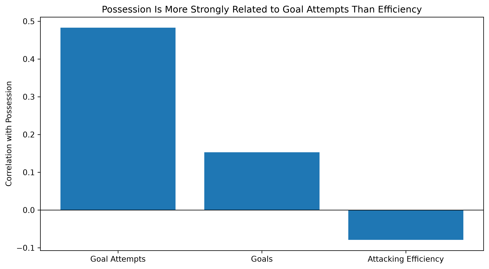
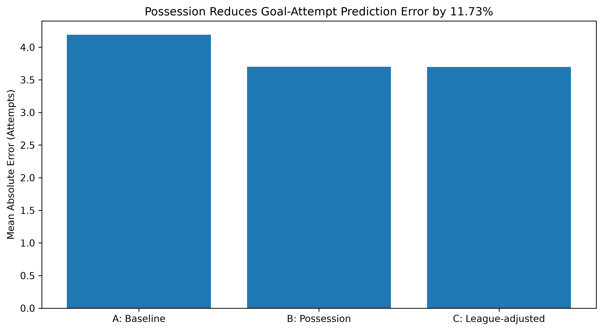
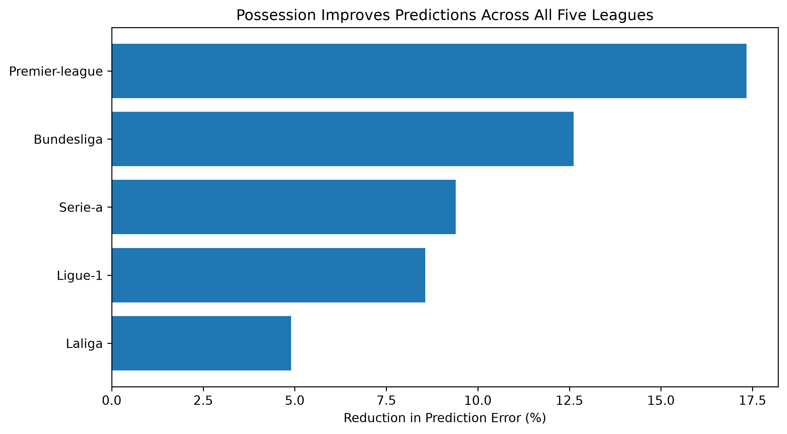

# Does More Possession Mean Better Attacking Performance in Soccer?

**Not necessarily. Possession is useful for understanding how many shots a team takes, but it tells us very little about how efficiently those shots become goals.**

**Recommendation:** Professional soccer clubs should evaluate possession, shot volume, and finishing efficiency separately instead of relying on possession alone.

## 1. Why does this matter?

Imagine two soccer teams:

- Team A controls 65% of possession but scores once from 15 shots.
- Team B controls 35% of possession but scores twice from 8 shots.

Which team had the better attack?

Possession tells us who controlled the ball, but it doesn't tell us the whole story about attacking performance.

For professional clubs, this distinction matters when evaluating matches and comparing team performance.

## 2. What did I find?

**Adding possession reduced the average error in estimating a team's number of goal attempts by 11.73%, but reduced the error for finishing efficiency by only 0.63%.**

This suggests possession is a useful supporting statistic for attacking volume, but not a reliable standalone measure of finishing quality.

## 3. The Evidence

### Chart 1: Possession relates more strongly to shots than finishing efficiency

Teams with more possession generally take more shots. However, they do not necessarily convert a higher percentage of their shots into goals.

### Chart 2: Adding possession reduces goal-attempt prediction error by 11.73%

Including possession reduced average error from 4.19 to 3.70 goal attempts per team-match.

Adjusting the model separately for each league offered almost no additional improvement.

### Chart 3: Possession improves goal-attempt predictions in all five leagues

The improvement ranged from 4.90% in La Liga to 17.33% in the Premier League.

## 4. The Check: Could This Finding Be Wrong?

To test whether my result held beyond the original training data, I evaluated the models on three later seasons.

| Season | Reduction in Prediction Error |
|---|---:|
| 2021/22 | 13.72% |
| 2022/23 | 10.80% |
| 2023/24 | 10.63% |

If possession failed to improve results in these seasons or across individual leagues, my recommendation would be much weaker.

Instead, the improvement was positive in all three testing seasons and all five leagues.

## 5. What I Did

I analyzed 33,884 team-match observations from five major European soccer leagues between 2013/14 and 2023/24. I compared possession with goal attempts, goals, and finishing efficiency, which I measured as goals divided by attempts. I then compared statistical models with and without possession to see whether it added useful information.

## 6. What This Analysis Cannot Tell Us

- **Correlation isn't causation:** More possession doesn't necessarily cause more shots or goals.
- **Not all shots are equal:** The dataset does not measure shot quality, such as expected goals (xG).
- **Not a pre-match forecast:** Possession and attempts are measured during the same match, so these results are best used for post-match evaluation.

## 7. Final Recommendation

Clubs should assess attacking performance using three distinct statistics:

**Possession → How much of the ball a team controls**

**Goal attempts → How frequently it creates shooting opportunities**

**Finishing efficiency → How often those attempts become goals**

Rather than treating high possession as evidence of an effective attack, clubs should use it as one part of a broader performance dashboard.

## Reproduce the Analysis

- **Source:** [Kaggle Football Match Statistics](https://www.kaggle.com/datasets/gokhanergul/football-match-statistics/data)
- **License:** MIT
- **Retrieved:** September 10, 2026
- **Notebook:** `Code.ipynb`
- **Dataset:** `Football.csv`
- **Tools:** Python, pandas, statsmodels, scikit-learn, matplotlib

To reproduce the results, install the required Python libraries, open `Code.ipynb` in Jupyter, restart the kernel, and run all cells from top to bottom.